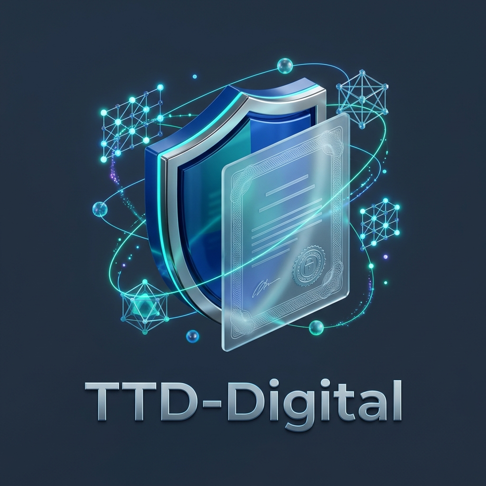

<p align="center">
  
</p>

<h1 align="center">Threshold Post-Quantum Document Signing (ML-DSA / FIPS 204)</h1>

<p align="center">
  <em>Sistem Tanda Tangan Dokumen Resmi Institusi Berbasis Ambang Batas (k-dari-n) Tahan Komputasi Kuantum</em>
</p>

<p align="center">
  <a href="https://github.com/digimetateam-hash/ttd-digital"></a>
  <a href="https://github.com/digimetateam-hash/ttd-digital"></a>
  <a href="https://github.com/digimetateam-hash/ttd-digital"></a>
  <a href="https://github.com/digimetateam-hash/ttd-digital"></a>
  <a href="https://github.com/digimetateam-hash/ttd-digital"></a>
</p>

---

> **Judul Riset:** *Threshold Post-Quantum Document Signing for Institutional Workflows: Design, Integration, and Empirical Evaluation*  
> **Algoritma Dasar:** ML-DSA (FIPS 204 / Dilithium) dengan fallback Ed25519.

Aplikasi web interaktif berbasis **Streamlit** untuk mendemonstrasikan, menguji, dan mengevaluasi penandatanganan dokumen resmi secara kolektif dengan skema threshold ($k$-dari-$n$) tahan komputasi kuantum.

---

## Fitur Utama

1. **📁 Dukungan Multi-Format Dokumen Resmi Institusi:**
   - 📝 **Microsoft Word (`.docx`)**: Surat Keputusan (SK), Perjanjian/Kontrak, Surat Tugas, Ijazah.
   - 📊 **Microsoft Excel (`.xlsx`)**: Rencana Anggaran Biaya (RAB / RAPBS), Laporan Keuangan, Daftar Honorarium.
   - 📑 **Format PDF (`.pdf`)**: Salinan dokumen portabel resmi, dokumen arsip PAdES.
   - 📄 **Teks Langsung / Input Form**: Untuk drafting naskah dan verifikasi instan.
2. **✍️ Alur Penandatanganan Kolektif ($k$-dari-$n$):**
   - Mendukung penandatanganan bersama tanpa satu pihak pun memegang kunci utuh.
   - Pengikatan kriptografis (*domain-separated digest* `THRESHDOC-v0`) yang mengikat biner dokumen (Word/Excel/PDF), ID unik dokumen, nilai ambang $k$, dan identitas seluruh penanda tangan.
3. **🛡️ Uji Negatif & Verifikasi Model Ancaman (RQ3):**
   - Uji otomatis penolakan manipulasi isi dokumen (*tampering* 1 huruf/angka di Word/Excel membatalkan tanda tangan).
   - Penolakan kuorum di bawah ambang ($< k$).
   - Pencegahan pemutaran ulang tanda tangan (*replay attack*) ke dokumen/ID lain.
   - Pencegahan penggantian daftar penanda tangan (*policy substitution*).
4. **📊 Evaluasi & Benchmark Kinerja Empiris (RQ1 & RQ4):**
   - Pengukuran latensi penandatanganan dan verifikasi (median & IQR).
   - Analisis perbandingan ukuran tanda tangan antara *Multisig Baseline* ($O(k)$) dan *True Threshold ML-DSA* ($O(1)$).
   - Ekspor laporan benchmark dan jejak audit langsung ke format **Excel (`.xlsx`)**.
5. **📦 Evaluasi Kontainer CMS & Kompatibilitas Dokumen (RQ2):**
   - Pemeriksaan kontainer ASN.1 CMS `SignedData` dengan OID `ML-DSA-65` (`2.16.840.1.101.3.4.3.18`).
   - Analisis kesiapan format PDF/PAdES dan pendekatan *hybrid co-signature*.

---

## Cara Menjalankan Secara Lokal

```bash
# 1. Clone repositori
git clone https://github.com/digimetateam-hash/ttd-digital.git
cd ttd-digital

# 2. Buat virtual environment & aktifkan
python3 -m venv .venv
source .venv/bin/activate

# 3. Pasang dependensi
pip install -r requirements.txt

# (Opsional) Untuk mengaktifkan algoritma pasca-kuantum ML-DSA FIPS 204:
# macOS: brew install liboqs && pip install liboqs-python
# Linux: pasang liboqs & pip install liboqs-python

# 4. Jalankan aplikasi Streamlit
streamlit run app.py
```

---

## Deploy ke Streamlit Cloud

1. Buka [share.streamlit.io](https://share.streamlit.io/).
2. Hubungkan akun GitHub Anda.
3. Pilih repositori: `digimetateam-hash/ttd-digital`.
4. Pilih cabang: `main`.
5. Tentukan Main file path: `app.py`.
6. Klik **Deploy**!

---

## Struktur Berkas

```
├── assets/
│   ├── logo-3d.png                # Visual Render 3D Hero Banner Landing Page
│   └── logo-3d.svg                # Vektor 3D Isometric Logo (Lattice & Shield)
├── docs/
│   ├── ERD.md                     # Entity Relationship Diagram & Relasi Data
│   ├── SCHEMA.md                  # Spesifikasi Skema Database, DDL SQL & Batasan Kripto
│   ├── RULES.md                   # Aturan Bisnis, Kriptografi & Tata Kelola Forensik
│   ├── DESIGN_MATERIAL3.md        # Panduan Desain Material Design 3 (M3) & UI/UX
│   ├── QUALITY_ASSESSMENT.md      # Laporan Evaluasi Kualitas Perangkat Lunak & RQ Matrix
│   └── EVALUATION_REPORT.md       # Laporan Hasil Uji Evaluasi Empiris Lengkap (30 Runs)
├── scripts/
│   └── evaluate_empirical.py      # Skrip Eksekusi Benchmark & Simulasi Jaringan RQ1-RQ4
├── reports/
│   ├── benchmark_rq1_30runs.csv   # Data mentah benchmark 30 runs per konfigurasi
│   └── simulation_rq4_network.csv # Data mentah simulasi jaringan & signer offline
├── tests/
│   └── test_threshold_docsign.py  # Suite Uji Otomatis & Uji Negatif Model Ancaman (RQ3)
├── pytest.ini                     # Konfigurasi pengujian pytest
├── app.py                         # Aplikasi utama dashboard Streamlit
├── threshold_docsign.py           # Modul logika kriptografi & baseline evaluasi
├── PRD_Threshold-PQ-Signature.md  # Dokumen spesifikasi kebutuhan riset & referensi
├── requirements.txt               # Daftar pustaka Python untuk Streamlit Cloud
├── .gitignore
└── README.md                      # Dokumentasi proyek
```
