```mermaid
flowchart LR
    subgraph FASE1 ["FASE 1: PERFORMA & HARDWARE (2026)"]
        S1["1. Engine Rust PyO3/WASM"]
        S2["2. Token HSM / PKCS#11"]
        S3["3. Aplikasi Mobile Biometrik"]
    end

    subgraph FASE2 ["FASE 2: INTEROPERABILITAS & HUKUM (2027)"]
        S4["4. Akreditasi BSSN & PSrE"]
        S5["5. PAdES LTV & TSA PQC"]
        S6["6. Standarisasi IETF / Adobe"]
    end

    subgraph FASE3 ["FASE 3: EKOSISTEM NASIONAL & RISET (2028-2030)"]
        S7["7. Integrasi SPBE & Srikandi"]
        S8["8. Jaringan Konsensus P2P"]
        S9["9. Auditor Forensik AI Vision"]
        S10["10. Publikasi Top-Tier Q1"]
    end

    FASE1 --> FASE2 --> FASE3
```

# 🚀 10 Strategi Rencana Pengembangan ke Depan (Strategic Roadmap)
## Sistem Tanda Tangan Dokumen Threshold Pasca-Kuantum (ML-DSA / FIPS 204)

Dokumen ini memetakan **10 pilar strategi pengembangan jangka menengah dan panjang (2026–2030)** untuk mentransformasi sistem prototipe riset ini menjadi infrastruktur tanda tangan dokumen elektronik tingkat nasional dan korporasi (*enterprise production-grade*), menjamin kepatuhan hukum, kedaulatan data, dan ketahanan terhadap komputer kuantum.

---

---

### 1. Migrasi Mesin Kriptografi ke Native Rust & WebAssembly (WASM)
* **Tujuan:** Meningkatkan performa eksekusi komputasi kisi (*lattice*), menjamin keamanan memori (*memory-safe*), dan memungkinkan penandatanganan di sisi klien (*client-side browser signing*).
* **Langkah Konkret:**
  * Membungkus pustaka C/Rust resmi standar NIST FIPS 204 (`liboqs` / `pqcrypto-dilithium`) menggunakan **PyO3** untuk modul backend Python.
  * Mengompilasi modul penandatanganan ke **WebAssembly (WASM)** sehingga pejabat dapat menandatangani dokumen langsung di peramban web (Chrome/Firefox/Safari) tanpa kunci privat pernah dikirim melintasi jaringan internet.

### 2. Integrasi Perangkat Keras Fisik (HSM, PKCS#11, & FIDO-PQC)
* **Tujuan:** Mengeliminasi risiko pencurian kunci dari memori RAM komputer.
* **Langkah Konkret:**
  * Mendukung antarmuka standar **PKCS#11** dan **FIPS 140-3 Level 3/4** untuk integrasi dengan *Hardware Security Module* (HSM) institusi (Thales, Utimaco, YubiKey).
  * Pecahan kunci (*secret shares*) disimpan di dalam partisi aman token fisik; operasi matematika parsial dijalankan langsung di dalam prosesor kartu cerdas (*smartcard*).

### 3. Aplikasi Penanda Tangan Seluler dengan Otentikasi Biometrik (Android & iOS)
* **Tujuan:** Memberikan kemudahan bagi pimpinan (Rektor, Kepala Dinas, Direktur) untuk mengesahkan dokumen di mana saja dengan otentikasi wajah/sidik jari.
* **Langkah Konkret:**
  * Membangun aplikasi mobile berbasis Flutter/React Native yang memanfaatkan **Apple Secure Enclave** dan **Android StrongBox Keymaster**.
  * Pejabat menerima notifikasi dorong (*push notification*), membaca dokumen, dan menyetujui kuorum menggunakan biometrik Face ID / Fingerprint.

### 4. Akreditasi Resmi BSSN & Penyelenggara Sertifikasi Elektronik (PSrE Indonesia)
* **Tujuan:** Menjamin keabsahan kekuatan hukum di pengadilan sesuai amanat **UU ITE No. 1/2024** dan **PP No. 71/2019**.
* **Langkah Konkret:**
  * Mendaftarkan arsitektur *non-escrow threshold* ke **Balai Sertifikasi Elektronik (BSrE - BSSN)** dan Komdigi.
  * Mengajukan sertifikasi kelaikan sistem elektronik untuk digunakan pada transaksi perbankan nasional (BI-RTGS) dan pengesahan ijazah digital nasional.

### 5. Stempel Waktu Pasca-Kuantum (PQC Time-Stamping) & PAdES Long-Term Validation (LTV)
* **Tujuan:** Memastikan dokumen tetap valid secara hukum 20 hingga 50 tahun ke depan (*archival longevity*).
* **Langkah Konkret:**
  * Mengintegrasikan protokol **RFC 3161 Time-Stamp Authority (TSA)** berbasis tanda tangan ML-DSA.
  * Mengimplementasikan profil **PAdES-B-LTV (ETSI EN 319 142-1)** dengan menyematkan seluruh rantai sertifikat, status CRL/OCSP pasca-kuantum, dan bukti stempel waktu ke dalam struktur internal berkas PDF.

### 6. Kontribusi Standarisasi Global (IETF RFC & Registry Adobe Acrobat)
* **Tujuan:** Memastikan dokumen bertanda tangan ML-DSA dapat dibuka dan diverifikasi tanpa galat di seluruh pembaca PDF global.
* **Langkah Konkret:**
  * Mengirimkan naskah rancangan standar (*Internet-Draft*) ke kelompok kerja **IETF LAMPS** (*Limited Additional Mechanisms for PKIX and SMIME*) untuk alokasi OID resmi pada format PDF.
  * Berkontribusi pada *open-source repository* **pyHanko** dan **PDF.js** untuk menambahkan parser native OID FIPS 204 `id-ml-dsa-65`.

### 7. Integrasi Sistem Pemerintahan Berbasis Elektronik (SPBE / SRIKANDI / LPSE)
* **Tujuan:** Adopsi langsung pada alur birokrasi pemerintahan dan pengadaan barang/jasa negara.
* **Langkah Konkret:**
  * Menyediakan **RESTful API Engine** dan **Webhook SDK** siap pakai.
  * Mengintegrasikan modul ke aplikasi **SRIKANDI** (Sistem Informasi Kearsipan Dinamis Terintegrasi Nasional), **SIPD** Kemendagri, dan sistem e-Katalog LPSE LKPP.

### 8. Protokol Jaringan Terdistribusi Peer-to-Peer (P2P Gossip Network)
* **Tujuan:** Mencegah ketergantungan pada satu peladen terpusat (*zero central coordination failure*).
* **Langkah Konkret:**
  * Membangun protokol pertukaran parsial tanda tangan menggunakan **libp2p** atau gRPC dengan enkripsi kanal **Mutual TLS (mTLS)** pasca-kuantum (ML-KEM / FIPS 203).
  * Node penanda tangan saling bertukar *partial signature* secara terdesentralisasi hingga batas ambang $k$ terpenuhi.

### 9. Asisten AI Auditor Forensik Multimodal (Vision & Legal Anomaly Detection)
* **Tujuan:** Mencegah penipuan dokumen visual (*deepfake document*, stempel palsu, klausul berbahaya) sebelum kuorum menandatangani.
* **Langkah Konkret:**
  * Mengintegrasikan model visi AI untuk memeriksa keaslian resolusi stempel cap basah fisik dan ketidaksesuaian tipografi (*typographical anomaly*).
  * Memperluas aturan *Strict Grounding* LLM untuk mendeteksi klausul kontrak yang bertentangan dengan perundang-undangan RI (klausul jebakan, angka ganda pada RAB).

### 10. Publikasi Ilmiah Top-Tier & Diseminasi Riset Internasional
* **Tujuan:** Mengukuhkan reputasi ilmiah dan membuktikan keunggulan inovasi riset di tingkat dunia.
* **Langkah Konkret:**
  * Menyusun naskah publikasi ilmiah berdasarkan dataset empiris benchmark 30 repetisi, analisis ukuran $O(1)$ vs $O(k)$, dan hasil evaluasi 22 skenario uji ancaman (RQ1–RQ4).
  * Mengirimkan naskah riset ke konferensi atau jurnal bergengsi peringkat **Q1** bidang keamanan siber (misalnya: *IEEE Transactions on Information Forensics and Security*, *USENIX Security Symposium*, atau *ACM Conference on Computer and Communications Security / CCS*).

---

## 📅 Matriks Waktu & Target Pencapaian (Milestone)

| Tahun | Fokus Utama | Target Kunci (Key Deliverables) |
|:---:|:---|:---|
| **2026** | **Fondasi & Performa** | Rilis modul Rust PyO3, antarmuka PKCS#11 token fisik, dan penyempurnaan dataset multi-format Word/Excel/PDF. |
| **2027** | **Kepatuhan & Sertifikasi** | Pengajuan audit akreditasi BSSN/Komdigi, penerapan stempel waktu PQC TSA, dan integrasi PAdES-LTV. |
| **2028** | **Adopsi Instansi Publik** | Pilot project implementasi pada 5 Universitas Negeri dan 3 Dinas Pemerintah Daerah (SPBE). |
| **2029** | **Desentralisasi & Mobile** | Peluncuran aplikasi mobile biometrik (Secure Enclave) dan jaringan konsensus kuorum P2P. |
| **2030** | **Kesiapan Penuh Era Kuantum (Q-Day)** | Seluruh dokumen dan arsip nasional telah 100% bermigrasi ke skema threshold pasca-kuantum FIPS 204. |
